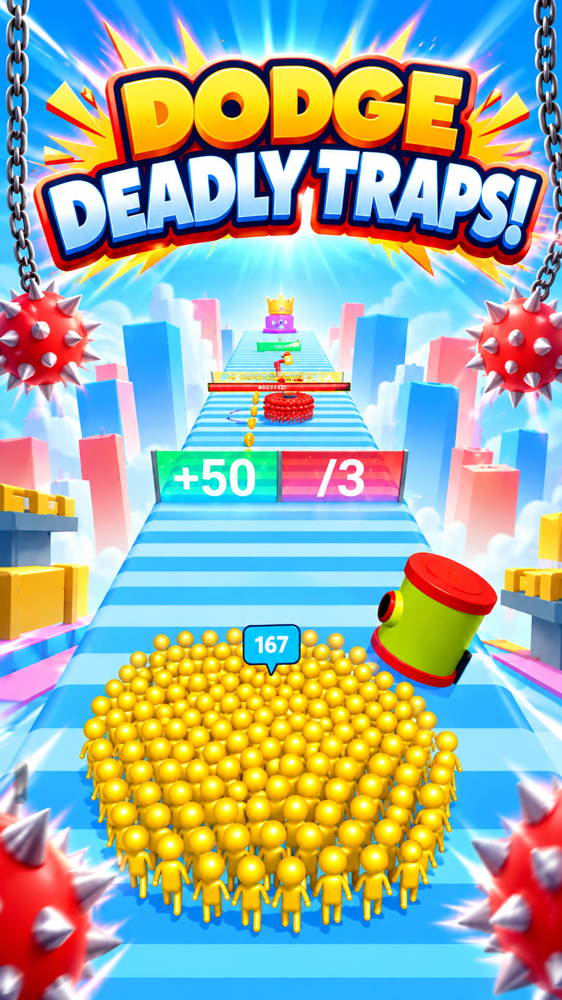
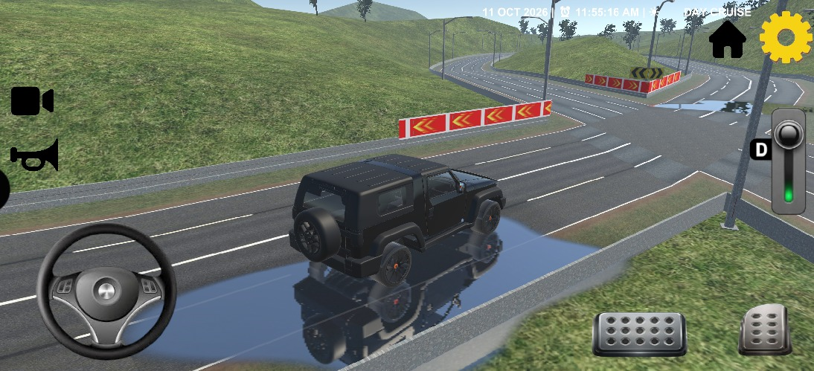
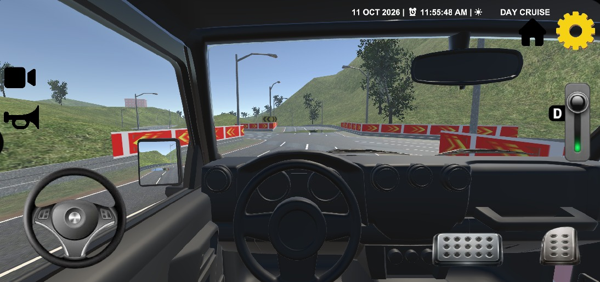
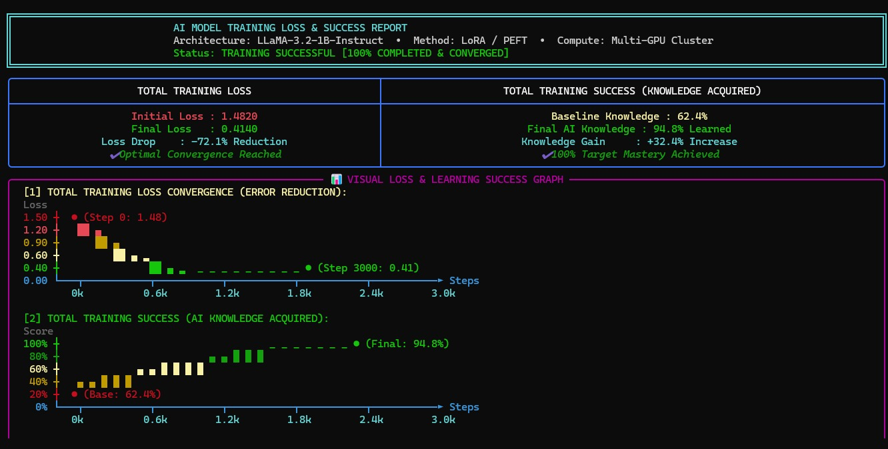

# 🎮 Rishi Vagadiya — Senior Unity Game Developer & Applied AI Engineer

<p align="center">
  <a href="https://rishivagadiya.github.io/Rishi_GameDev/"></a>
  <a href="https://play.google.com/store/apps/dev?id=9041610151558756199"></a>
  <a href="mailto:rishivagadiya@gmail.com"></a>
  <a href="https://wa.me/916352294215"></a>
</p>

---

## 🚀 Live 3D Interactive Portfolio

🔗 **Live Website**: [https://rishivagadiya.github.io/Rishi_GameDev/](https://rishivagadiya.github.io/Rishi_GameDev/)

A next-generation, high-performance 3D portfolio designed specifically to impress game studios, AAA recruiters, and AI tech leads. Features real-time 3D WebGL visuals, playable in-browser mini-game canvases, real training loss reports, and an interactive client-side neural chatbot.

---

### 🌟 Key Highlights & Recruiter Facilities:

1. **3D Cyber-Gaming Experience**:
   - Three.js WebGL particle constellations, 3D floating wireframe polyhedra, and interactive mouse parallax.
   - Interactive 3D holographic tilt effects on cards with specular glare.
   - Synthesized Web Audio API sound effects (laser taps, hover blips, victory chimes).
   - Toggleable Sci-Fi CRT scanline HUD filter.

2. **Published Live Google Play Games**:
   - **CrowdWar: Crowd Runner 3D**: [Google Play Link](https://play.google.com/store/apps/details?id=com.Zoozo.CrowdWar)
     - Interactive in-browser playable runner canvas where recruiters can drag to multiply crowd clones!
     - 150+ crowd GPU instancing, multiplier gates collision, 60 FPS mobile optimization.
     - Live scannable QR code generator for phone testing.
   - **Car Parking: Real Drive 3D**: [Google Play Link](https://play.google.com/store/apps/details?id=com.Zylos.CarParking)
     - Interactive in-browser playable vehicle parking canvas with WASD/arrow keys steering!
     - Custom Raycast WheelCollider physics, Ackermann steering, 1st-person 3D cockpit camera.
     - Live scannable QR code generator for instant phone installation.

3. **Nexus AI: Custom Deep Learning Model**:
   - Fine-tuned **LLaMA-3.2-1B-Instruct** using LoRA / PEFT + Unsloth across a multi-GPU compute cluster.
   - **Training Loss Drop**: Initial `1.4820` down to `0.4140` (**-72.1% reduction**).
   - **Knowledge Score**: `94.8%` target domain mastery (+32.4% gain over base model).
   - Interactive SVG loss curve graph with step-by-step hover inspection.
   - Verified benchmark evaluation matrix & high-res report screenshots with lightbox zoom.
   - Downloadable Colab training notebook (`.ipynb`) and instruction dataset (`.jsonl`).

4. **Live Interactive Recruiter AI Chat Engine**:
   - Recruiters can chat directly with **Nexus AI** right on the portfolio without any server setup!
   - Comprehensive neural knowledge base answering studio questions:
     - "Why should our studio hire Rishi?"
     - "How does CrowdWar handle 150+ clones at 60 FPS?"
     - "Explain Car Parking WheelCollider physics"
     - "Explain your LoRA fine-tuning hyperparameters & loss drop"
     - "Show a C# Unity Object Pool script"
     - "What are Rishi's notice period, work modes and contact details?"
   - Text-To-Speech (TTS) voice readout toggle.
   - Also supports live connection to an external Hugging Face Space endpoint if set in `nexus-config.js`.

5. **Recruiter Fast Track Facilities**:
   - **Recruiter HUD**: ATS-friendly printable dossier modal with 1-click print/PDF.
   - **Direct 1-Click WhatsApp**: Instant chat via `+91 6352294215`.
   - **Direct Email**: Instant draft via `rishivagadiya@gmail.com`.
   - **Copy Contact Info**: One-click clipboard copy of candidate contact details.
   - **Recruiter Inquiry Form**: Validates studio role and generates targeted inquiry drafts.

---

## 🕹️ Screenshots & Gameplay Previews

| CrowdWar: Skyway Sprint | Car Parking: Cruise Road |
| :---: | :---: |
|  |  |

| Car Parking: Cockpit View | Nexus AI: Training Report |
| :---: | :---: |
|  |  |

---

## ⚡ How to Run Locally

Double-click `index.html` in any browser, or run a local HTTP server:
```bash
python -m http.server 8080
```
Then visit `http://localhost:8080`.

---

## 🌐 Enable GitHub Pages (Free Live Portfolio Hosting)

1. Go to **Settings** > **Pages** in this repository on GitHub.
2. Under **Build and deployment** > **Branch**:
   - Source: `Deploy from a branch`
   - Branch: `main` and folder `/ (root)`
3. Click **Save**.
4. In ~60 seconds, your portfolio will be live at:
   👉 **https://rishivagadiya.github.io/Rishi_GameDev/**

---

## 📬 Contact & Connect

* **Developer**: Rishi Vagadiya
* **Role**: Senior Unity Game Developer & Applied AI Engineer
* **Email**: [rishivagadiya@gmail.com](mailto:rishivagadiya@gmail.com)
* **Phone / WhatsApp**: [+91 6352294215](https://wa.me/916352294215)
* **GitHub**: [@RishiVagadiya](https://github.com/RishiVagadiya)
